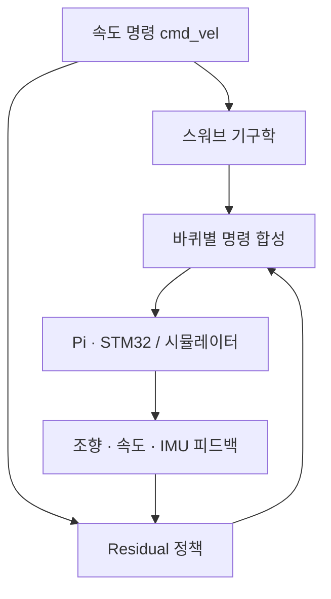

# KSRC Rover — Swerve Control, Residual RL & Mapping

2026 대한민국 우주로버 경진대회를 위해 개발한 4륜 독립조향 로버의 제어·강화학습·매핑 코드입니다. 스워브 기구학과 STM32 구동 제어, Isaac Lab의 Teacher–Student Residual RL, MuJoCo 검증 환경, D435 기반 3D 매핑·경로 계획을 담고 있습니다.

**Python · C/C++ · ROS 2 · Isaac Lab · MuJoCo · ORB-SLAM3 · Open3D**

[주요 기능](#주요-기능) · [시스템 구성](#시스템-구성) · [코드 구조](#코드-구조) · [실행 방법](#실행-방법)

## 주요 기능

- **스워브 제어**: `cmd_vel`에서 바퀴별 조향각·구동 명령을 계산하고 조향 범위·구동 정렬 게이트 적용
- **임베디드 제어**: STM32의 바퀴 속도 FF+PI 제어와 Raspberry Pi 명령·텔레메트리 통신
- **Residual RL**: 기구학 명령 위에 바퀴별 잔차를 더하는 정책과 Teacher–Student 학습
- **시뮬레이션**: Isaac Lab 학습, MuJoCo의 구동기·슬립·침하 모델 및 정책 검증
- **매핑·측위**: D435 영상·깊이 수집, ORB-SLAM3, TSDF 재구성, ESKF 센서 융합
- **지형·경로 계획**: 경사·거칠기·단차 기반 costmap, 임무 경로 생성, MPPI 및 실기 배포 코드

## 시스템 구성

| 계층 | 구성 |
|---|---|
| 플랫폼 | 4륜 독립조향·독립구동, 로커 링크 |
| 저수준 제어 | STM32 Nucleo-F446RE, 구동 모터·조향 서보, FF+PI |
| 상위 제어 | Raspberry Pi 5, 속도 명령·정책 실행·텔레메트리 |
| 학습·검증 | Isaac Lab, MuJoCo, Teacher–Student Residual RL |
| 인지·주행 | D435, ORB-SLAM3, TSDF·지형 지도, ESKF·경로 계획 |

제어·RL의 기준 구현은 `firmware/`, `sim/`, `pi/`, `ros/`에 있고, 매핑 스택은 `mapping/`을 별도 실행 루트로 사용합니다.



## 코드 구조

| 경로 | 내용 | 먼저 볼 코드·문서 |
|---|---|---|
| [firmware/common](firmware/common/) | 기구학·정렬 게이트·PI·통신 프레임 | [swerve_kinematics.c](firmware/common/swerve_kinematics.c), [wheel_pi.c](firmware/common/wheel_pi.c) |
| [firmware](firmware/) | STM32 프로젝트·보드 제어 | [README](firmware/README.md) |
| [sim/isaac/ksrc_rover](sim/isaac/ksrc_rover/) | Isaac Lab 환경·학습·평가 | [source/ksrc_rover/](sim/isaac/ksrc_rover/source/ksrc_rover/), [CLI](sim/isaac/ksrc_rover/CLI.md) |
| [sim/rl](sim/rl/) | MuJoCo 물리·정책 검증 | [sim2sim_isaac.py](sim/rl/sim2sim_isaac.py) |
| [pi](pi/) | 실기 정책 실행·텔레옵 | [policy/](pi/policy/), [README](pi/README.md) |
| [ros](ros/) | 로봇 모델·Nav2·시뮬레이션 브리지 | [isaac_bridge.py](ros/isaac_bridge.py) |
| [mapping/experiments/handheld_mapping](mapping/experiments/handheld_mapping/) | 영상 수집·지도 재구성·지형 지도 | [terrain.py](mapping/experiments/handheld_mapping/terrain.py), [costmap.py](mapping/experiments/handheld_mapping/costmap.py) |
| [mapping/experiments/localization](mapping/experiments/localization/) | 위치 추정·센서 융합 | [소스](mapping/experiments/localization/) |
| [mapping/deployment](mapping/deployment/) | 실기 매핑·주행·중계 화면 | [소스](mapping/deployment/) |
| [mapping/tests](mapping/tests/) | 매핑·주행 모듈 테스트 | [지형 테스트](mapping/tests/handheld_mapping/test_terrain.py) |
| [examples](examples/) | 센서 없이 실행하는 지형 처리 예제 | [terrain_costmap_demo.py](examples/terrain_costmap_demo.py) |

## 실행 방법

### 1. 센서 없이 지형·costmap 생성

Python 3.10 이상에서 NumPy·SciPy를 사용합니다.

```bash
git clone https://github.com/YunBeeeen/ksrc.git
cd ksrc
python3 -m pip install numpy scipy
python3 examples/terrain_costmap_demo.py
```

합성 평면을 기존 `TerrainGrid`에 누적하고 경사·거칠기·단차를 계산한 뒤 costmap의 격자 크기와 유효 셀 수를 출력합니다.

### 2. MuJoCo에서 기구학 주행

GCC와 MuJoCo·PyTorch·PyYAML·NumPy를 준비합니다. 아래 명령은 저장소 루트에서 실행하며 학습 체크포인트 없이 IK 기준 주행을 생성합니다.

```bash
python3 -m pip install mujoco torch pyyaml numpy
bash sim/build.sh
mkdir -p outputs
python3 sim/rl/sim2sim_isaac.py \
  --action Res8 --policy ik --scenario rough_sand --episodes 1 \
  --out outputs/ik_rough_sand.npz
```

RL 정책을 실행할 때는 체크포인트와 같은 실행의 `params/env.yaml`, `params/agent.yaml`을 함께 준비합니다. 세부 옵션은 [학습·평가 실행 안내](sim/isaac/ksrc_rover/CLI.md)를 참고하세요.

### 3. 매핑·학습·실기 실행

| 실행 경로 | 안내 |
|---|---|
| Isaac Lab 학습·평가 | [Isaac README](sim/isaac/ksrc_rover/README.md), [CLI](sim/isaac/ksrc_rover/CLI.md) |
| D435·ORB-SLAM3 매핑 | [매핑 소개](mapping/README.md), [실행 위치·환경](mapping/INTEGRATION.md) |
| ROS 2·Nav2 | [전체 명령](CLI.md), [로봇 모델](ros/rover_description/README.md) |
| Pi·STM32 실기 제어 | [Pi 안내](pi/README.md), [펌웨어 안내](firmware/README.md) |

매핑 코드의 원본 문서에서 저장소 루트를 지칭하는 경로는 이 저장소의 `mapping/`에 해당합니다. 센서·ROS·Isaac 환경과 모델 파일은 각 실행 경로에 맞춰 준비합니다.

## 관련 문서

- [전체 실행 명령](CLI.md)
- [매핑 소스 출처·외부 라이선스](mapping/third_party/README.md)
- [매핑 소스 가져오기 기록](mapping/INTEGRATION.md)
- [보관된 개발 기록](docs/ARCHIVE.md)
